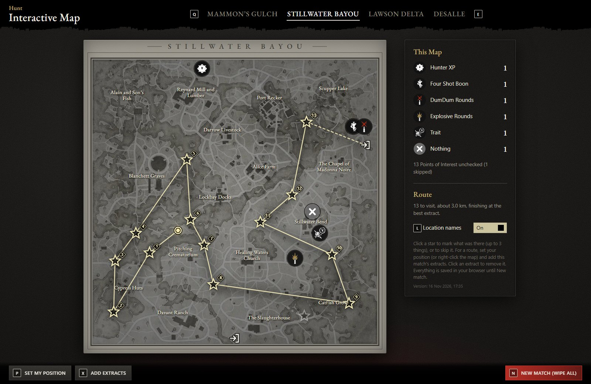

# Hunt Interactive Map

A fan-made companion map for **Hunt: Showdown 1896**. Once your team has cleared the lobby, mark what you found at each tower, and it plans the shortest run to the rest, finishing at an extract. Built for chasing Hunter XP envelopes to get a hunter to level 50 and retire them.

**[Open the map in your browser](https://sam-duckett.github.io/hunt-interactive-map/)**: nothing to install, and it works on any PC.



*Fan project, not affiliated with or endorsed by Crytek. See [Credits and legal](#credits-and-legal).*

## Features

- All four maps (Mammon's Gulch, Stillwater Bayou, Lawson Delta, DeSalle) with every tower and location name
- Mark up to three things per tower: Hunter XP, Four Shot Boon, DumDum, Explosive, Trait, or Nothing
- A planned route through the towers you haven't checked, finishing at the best extract
- Skip towers that aren't worth the run
- Keyboard shortcuts, styled after the game's own menus
- Everything is saved in your browser until you start a new match

## Two ways to use it

- **Online:** open [the website](https://sam-duckett.github.io/hunt-interactive-map/). It's best on a second monitor, or alt-tab to it after the lobby is clear.
- **Offline:** download [`dist/hunt-interactive-map.html`](dist/hunt-interactive-map.html) (use the download button on that page) and double-click it. It's one self-contained file, with the maps, icons and code all inside, and works without the internet.

Marks made on the website and in the downloaded file are saved separately, because each one keeps its own copy in your browser.

## The next step: an in-game overlay (help wanted)

The goal is to turn this into an **overlay**: press a hotkey in game and the map opens over Hunt, press it again and you're straight back in. A working prototype exists. It's built so it never touches the game: it's a separate window, with no injection, no memory reading, and no input sent to the game, the same kind of thing as a notes app pinned on top.

To release it properly, the project needs:

1. **Crytek's blessing.** The maps and icons are Crytek's artwork, and an overlay should have their OK on fair play before anyone uses it in matches.
2. **Awareness.** The more Hunt players who find this useful, the more likely the right people notice it.

**How you can help:**

- ⭐ **Star this repo**, so it's easier to find and shows there's interest.
- **Share it** with friends you play Hunt with.
- **Open an issue** with feedback, bugs, ideas, or a missing or misplaced tower. A screenshot of the in-game map helps a lot.
- **From Crytek?** We'd love to talk. Please open an issue and we'll get in touch.

## Usage

1. Pick the map you're playing on using the tabs along the top (or `Q` / `E`, or `1`–`4`).
2. Stars are towers that haven't been checked yet. Click one and choose what was there:
   - Hunter XP
   - Four Shot Boon
   - DumDum Rounds
   - Explosive Rounds
   - Trait
   - Nothing
3. You can pick up to 3 things per tower (for example Hunter XP and a Trait). Click an option again to remove it. **Nothing** can't be combined with the others. The star becomes the icons you picked. `Esc` or clicking elsewhere closes the picker.
4. The side panel shows how many of each type you've found on the current map and how many towers are still unchecked.
5. Not worth the run to a far-off tower? Click it and choose **Skip this tower**. It turns into a faded grey star and is left out of the route. Click it again to include it.
6. For a route, press **Set my position** (`P`) and click where you are on the map, or just right-click the map. Then press **Add extracts** (`X`), click each extract for this match, and press it again when you're done. Click an extract to remove it. Whenever you mark a tower, your position moves to it, so the route always starts from the last tower you checked. The route numbers every unchecked tower in order and finishes at whichever extract makes the whole run shortest (the last leg is dashed). It updates as you mark towers. It uses straight lines, so it doesn't know about water, cliffs or roads.
7. Turn **Location names** on or off (`L`) to show the named places (Catfish Grove and so on).
8. When the match is over, press **New match (wipe all)** (`N`). It asks you to press it again within 3 seconds to confirm. This also clears your position, extracts and skipped towers.

### Keyboard shortcuts

| Key | Does |
|---|---|
| `Q` / `E` | Previous / next map |
| `1`–`4` | Mammon's Gulch, Stillwater Bayou, Lawson Delta, DeSalle |
| `P` | Set my position (then click the map) |
| `X` | Add extracts (press again when done) |
| `L` | Location names on/off |
| `N` | New match (press twice) |
| `Esc` | Close the picker or cancel placing |

Marks, skipped towers, your position and extracts are saved in your browser, so refreshing the page or closing it keeps them. They are only cleared by **New match (wipe all)**. Marks are kept per map, so you can switch tabs mid-match without losing anything. If you use a different browser, or open the file from a different place, you start with a blank map, because each browser keeps its own copy.

## Icons

Icons live in `src/icons/`:

```
src/icons/hunter-xp.png
src/icons/four-shot.png
src/icons/dumdum.png
src/icons/explosive.png
src/icons/trait.png
src/icons/nothing.svg
```

Hunter XP, Four Shot, DumDum, Explosive and Trait use icons cut from the game; Nothing is a simple placeholder (`.svg`). To swap one, save it in `src/icons/` and change its file name in the `TYPES` list at the top of `src/main.js`. Square images work best, and the dark circle behind the icon should be part of the image itself. If a file fails to load, that type shows a coloured circle with a short label (XP, 4, DD, EX, T, ✕).

## Development

Only needed if you're editing the code. Requires Node.js.

```bash
npm install
npm run css     # compiles src/styles.scss to src/styles.css (watch mode)
```

Open `src/index.html` directly in a browser while developing. `src/styles.css` is generated from `src/styles.scss` and isn't committed, so run `npm run css` (or `npm run build`) once after cloning. Edit anything in `src/`, never `dist/`.

After any change (code, icons, maps or coordinates), rebuild the single-file version and commit it:

```bash
npm run build   # compiles the SCSS, then writes dist/hunt-interactive-map.html
```

Pushing to `main` republishes the website automatically from the committed `dist/` file.

## Project structure

```
src/                    the app (everything the page needs)
  index.html            page markup (open this while developing)
  main.js               app logic
  map-data.js           tower positions and location names per map
  styles.scss           styles source
  styles.css            compiled styles (generated, not committed)
  maps/                 map images: mammons-gulch, stillwater-bayou, lawson-delta, desalle (.webp)
  icons/                marker icons (see above)
  fonts/                EB Garamond for location names (SIL Open Font License, see OFL.txt)
dist/                   the single-file build to share (committed)
build.js                bundles src/ into dist/hunt-interactive-map.html
docs/                   README screenshot
.github/workflows/      publishes dist/ as the website on every push to main
```

## Changing the map data

`src/map-data.js` is keyed by map id (the image file name without `.webp`). Each tower is `[x, y]` as a percentage from the top-left of the image. To add a map, add its image to `src/maps/`, its coordinates to `src/map-data.js`, and an entry to the `NAMES` list in `src/main.js`. Location names go in the `window.MAP_LABELS` object in the same file, as `[name, x, y]`; a map with no entry just shows no names.

## Credits and legal

- **Hunt: Showdown 1896**, its name, map images and in-game icons are the property of **Crytek GmbH**. They're used here for a free, non-commercial fan project. This project isn't affiliated with, endorsed by or sponsored by Crytek.
- The project's own code is under the [MIT licence](LICENSE). That covers the code only, not Crytek's assets.
- Location names use [EB Garamond](https://github.com/octaviopardo/EBGaramond12), under the SIL Open Font License (`src/fonts/OFL.txt`).
